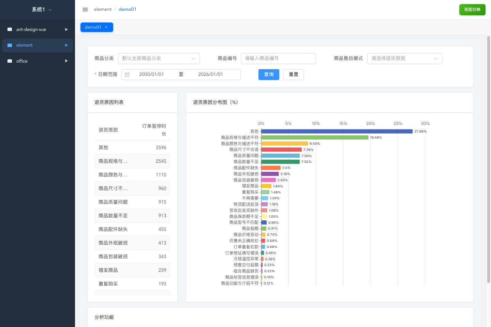

<a id="top"></a>
<div align="center">

# 🚀 Libra Boot Vue

**通过 vue3-sfc-loader 在浏览器中读取、解析并挂载 Vue 单文件组件（SFC，`.vue`），配合静态引入的 Element Plus 等组件库构建轻量页面，无需 npm 安装或 Vite 预构建。**

[](https://vuejs.org/)
[](https://github.com/FranckFreiburger/vue3-sfc-loader)
[](LICENSE)

[English](README_EN.md) | **简体中文**

</div>

> **本文遵循开源说明规范**：结构与徽章按统一体例，徽章仅指向公开可访问资源，版本信息指向发布渠道动态页。

**源码**：[GitHub](https://github.com/halavah/libra-boot-vue) · [Gitee](https://gitee.com/halavah/libra-boot-vue)

**使用说明**：本文包含静态运行、组件挂载、目录和限制的完整步骤。

**版本与更新**：[GitHub Tags](https://github.com/halavah/libra-boot-vue/tags) · [Releases](https://github.com/halavah/libra-boot-vue/releases)

## 📖 目录

- [快速开始](#quick-start)
- [运行截图](#screenshots)
- [获取源码](#source)
- [浏览器如何加载组件](#runtime)
- [挂载自己的组件](#component)
- [目录结构](#structure)
- [可选的 Vite 开发方式](#vite)
- [限制与排错](#limits)
- [验证范围](#verification)
- [贡献指南](#contributing)
- [License](#license)
- [联系我们](#contact)
- [Star History](#star-history)
- [回到顶部](#back-to-top)

<a id="quick-start"></a>
## 🚀 快速开始

准备 Git、Python 3，以及支持 Vue 3、Fetch 和现代 JavaScript 的浏览器。Python 仅用于提供静态 HTTP 服务，也可使用已有的静态服务器；这条运行路径不需要 Node.js、npm 或 pnpm。

```sh
git clone https://github.com/halavah/libra-boot-vue.git
cd libra-boot-vue
python3 -m http.server 5174 --bind 127.0.0.1
```

在**仓库根目录**启动服务，然后打开：

- 示例目录：`http://127.0.0.1:5174/test/index.html`
- Element Plus 示例：`http://127.0.0.1:5174/test/load-component.html?component=element/demo01`
- Ant Design Vue 示例：`http://127.0.0.1:5174/test/load-component.html?component=ant-design-vue/demo01`

目录页列出 SFC 和独立 HTML 示例；选择 SFC 后，浏览器请求源码、运行时解析并挂载组件。接口型示例仍需要对应服务。按 `Ctrl+C` 停止静态服务；端口占用时改用其他空闲端口，并同步修改访问地址。不要直接双击 HTML 使用 `file://`，加载器需要通过 HTTP 获取组件和资源。

<a id="screenshots"></a>
## 🖼️ 运行截图

以下为仓内 Vite 辅助示例的真实运行截图，展示组件与图表效果；不代表所有静态入口或后端接口均已验收。画面使用虚构电商数据。


*退货原因列表与 ECharts 图表，使用本地演示数据。*


*文件处理控件与布局；真实上传需要接入后端。*

<a id="source"></a>
## 📦 获取源码

| 渠道 | 获取方式 | 说明 |
|---|---|---|
| GitHub 公开源码 | 上方 HTTPS 克隆命令，或下载 ZIP | 主分支为 `master` |
| Gitee 源码镜像 | 下方 SSH 命令 | SSH 访问需先在 Gitee 配置公钥 |
| npm 包、托管业务后端 | 不提供 | 按源码和静态资源使用 |

使用 Gitee 时执行以下命令，之后在仓库根目录运行同一条 Python 静态服务命令：

```sh
git clone git@gitee.com:halavah/libra-boot-vue.git
cd libra-boot-vue
python3 -m http.server 5174 --bind 127.0.0.1
```

保留 `test/`、`src/`、`public/` 的相对位置。当前入口使用 `/public/...`、`/src/...` 绝对 URL 路径，必须把仓库根目录作为静态服务根目录；子路径托管需要先调整资源路径。对外部署应只发布所需页面、组件与浏览器依赖，不把 `.git`、环境文件或 `node_modules` 暴露为静态资源。

<a id="runtime"></a>
## 🧩 浏览器如何加载组件

SFC（Single-File Component，单文件组件）把模板、逻辑和样式放在一个 `.vue` 文件中。静态加载入口是 `test/load-component.html`，核心过程如下：

1. 通过 `<script>` 和 `<link>` 从 `public/` 引入 Vue、Element Plus、Ant Design Vue、ECharts、Axios、Day.js 等浏览器资源。
2. 从 `component` 查询参数取得分组和示例名，例如 `element/demo01`。
3. 使用 `vue3-sfc-loader.loadModule()` 加载 `/src/views/element/demo01/index.vue`。
4. `moduleCache` 将 `vue`、`element-plus` 等导入名映射到已引入的全局对象；`getFile()` 使用 Fetch 读取源码，`addStyle()` 把组件样式加入页面。
5. 通过 `defineAsyncComponent()` 创建异步组件，注册组件库，再用 `createApp().mount()` 挂载到页面的 `#app`。

`.vue` 在浏览器运行时解析，不要求先打包；浏览器仍会执行加载和编译工作。“轻量”指使用方式和接入流程，不代表依赖体积已精简或运行时编译没有开销。

<a id="component"></a>
## ✍️ 挂载自己的组件

在 `src/views/element/hello/index.vue` 新建下面的普通 Vue SFC：

```vue
<template>
  <el-button type="primary" @click="count++">
    点击次数：{{ count }}
  </el-button>
</template>

<script>
export default {
  data() {
    return { count: 0 }
  }
}
</script>
```

保持静态服务运行，打开 `http://127.0.0.1:5174/test/load-component.html?component=element/hello`。加载器按既有约定查找该目录下的 `index.vue`；参数不带 `.vue` 后缀，也不是任意文件 URL。

需要在目录页显示时，将 `hello` 加到 `test/views.json` 的 `element` 数组中。这是手动目录配置，不会自动扫描文件系统。独立 HTML 示例由 `test/views2.json` 登记，链接指向 `src/views2/<分组>/<示例>/index.html`。

组件可以沿用示例中的 `js/`、`css/` 分文件组织。新增依赖时，需提供相应浏览器资源并更新 `moduleCache`；仅在 `package.json` 增加依赖，不会让静态加载器自动识别该包。

<a id="structure"></a>
## 🗂️ 目录结构

```text
test/
├─ index.html             # 手动示例目录
├─ load-component.html    # 浏览器 SFC 加载与挂载入口
├─ views.json             # SFC 目录配置
└─ views2.json            # 独立 HTML 目录配置
public/                   # 静态脚本、组件库样式、资源与第三方许可
src/
├─ views/                 # 加载器按“分组/示例/index.vue”查找组件
├─ views2/                # 独立 HTML 等示例
├─ views3/                # 文件处理与表单示例
├─ App.vue / Home.vue     # 可选 Vite 应用
├─ layouts/ / router/     # Vite 应用的布局与路由
├─ mixins/ / plugins/     # 可复用逻辑
└─ assets/                # 样式与演示资源
assets/screenshots/       # README 运行截图
```

<a id="vite"></a>
## 🛠️ 可选的 Vite 开发方式

仓内同时保留 Vite 应用，适合需要工程化路由与开发服务的使用场景。这是独立的运行方式，环境基线为 Node.js 22 或更新版本、pnpm 9 或更新版本：

```sh
pnpm install --frozen-lockfile
pnpm dev --host 127.0.0.1 --port 5173 --strictPort
```

打开 `http://127.0.0.1:5173/`。`pnpm build` 生成 `dist/`；构建后执行 `pnpm preview --host 127.0.0.1 --port 4173 --strictPort` 预览。Vite 的自动发现、依赖解析与构建结果不等于 `test/` 静态加载器的行为，静态入口仍按前述 HTTP 服务方式运行。

<a id="limits"></a>
## ⚠️ 限制与排错

| 现象或边界 | 核对方式 |
|---|---|
| `.vue`、脚本或样式返回 404 | 确认服务根目录；`component=element/demo01` 对应 `src/views/element/demo01/index.vue` |
| 缺少全局样式 | 当前入口引用的 `/styles/global.css` 未随仓提供；使用时补充需要的样式或调整入口引用 |
| 目录链接没有组件 | 两个 `demo06-less不可用` 及旧 `office` 路径不保证有对应入口，逐项核对文件，不把目录当作可用性清单 |
| 新包导入失败 | 检查浏览器脚本及 `moduleCache`，加载器不会自动使用 npm 依赖树 |
| 相对路径、JSON 或预处理样式报错 | 当前 `pathResolve()` 有指定前缀和路径改写；`../json/` 被忽略，不保证支持任意 Vite 别名、Less/Sass 或插件 |
| 上传、鉴权或业务查询失败 | 接入自己的后端；不可用占位域名和 localhost 接口不是托管业务服务 |

只加载自己维护或可信来源的组件：SFC 中的 JavaScript 会在当前页面执行。接口示例使用演示数据或占位地址，项目没有统一 Mock 后端，也不承诺每个示例都能独立离线运行。

<a id="verification"></a>
## ✅ 验证范围

说明中的加载路径、脚本依赖、库映射与挂载过程已按源码核对；截图文件存在。静态入口仍存在上表列出的缺失资源与历史目录项。没有把源码检查或辅助 Vite 应用截图当作全部静态组件、真实上传、后端鉴权或移动端兼容测试通过。

<a id="contributing"></a>
## 🤝 贡献指南

从 `master` 创建功能分支，或 Fork 后提交 PR。保持原有组件、目录与代码格式；涉及入口、依赖映射或目录配置时，同步验证受影响的静态路径及中英文 README。提交说明写清实际执行和未执行的检查。

示例数据使用虚构电商场景，不提交真实账号、私有接口、凭据、环境文件或未经许可的资源；第三方许可随资源保留。

<a id="license"></a>
## 📄 License

[MIT License](LICENSE) 适用于项目自有代码。允许商业使用、修改、分发和私有使用；副本或实质性部分需保留版权与许可声明，不提供担保。选择 MIT 便于复用轻量页面和组件示例；`public/` 中第三方资源继续遵守各自许可。

<a id="contact"></a>
## 📮 联系我们

维护者：[halavah](https://github.com/halavah)。请通过 [Issues](https://github.com/halavah/libra-boot-vue/issues) 或 PR 提供文件位置、复现步骤和脱敏证据。

<a id="star-history"></a>
## ⭐ Star History

如果项目对你有帮助，欢迎 Star 支持。

[](https://www.star-history.com/#halavah/libra-boot-vue&Date)

<a id="back-to-top"></a>
## ⬆ 回到顶部

用 ❤️ 构建 | Made with ❤️

[⬆ 回到顶部](#top)
