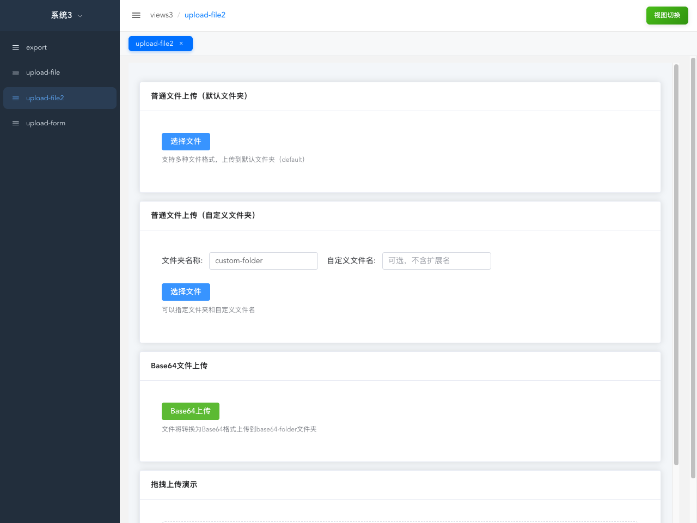

<a id="top"></a>
<div align="center">

# 🚀 Libra Boot Vue

**供开发者运行、阅读和复用组件、图表、文件控件与自动导航的 Vue 示例工程。**

[](https://vuejs.org/)
[](https://vite.dev/)
[](LICENSE)

[English](README_EN.md) | **简体中文**

</div>

> **本文遵循开源说明规范**：结构与徽章按统一体例，徽章仅指向公开可访问资源，版本信息指向发布渠道动态页。

---

## 📖 目录

- [快速开始](#quick-start)
- [运行截图](#screenshots)
- [安装与源码](#installation)
- [示例与边界](#examples)
- [目录结构](#structure)
- [静态预览](#static-preview)
- [验证与排错](#verification)
- [贡献指南](#contributing)
- [License](#license)
- [联系我们](#contact)
- [Star History](#star-history)
- [回到顶部](#back-to-top)

---

<a id="quick-start"></a>
## 🚀 快速开始

准备 Node.js 22 或更新版本、pnpm 9 或更新版本；克隆源码后，在工程根目录执行：

```sh
pnpm install --frozen-lockfile
pnpm dev --host 127.0.0.1 --port 5173 --strictPort
```

打开 `http://127.0.0.1:5173/`。当前首页扫描出 3 个系统、22 个 Vue 页面；展开系统3，点击 `upload-file2` 可查看文件处理控件。页面数量来自当前源码扫描，不作为固定接口承诺。

pnpm 若阻止依赖构建脚本，应按本机策略核对提示的依赖，不要全局关闭校验。

Vite 在 5173 端口提供开发服务；`--strictPort` 会在端口占用时停止启动，不会悄悄更换地址。需要换端口时显式修改命令。Vue 渲染组件，Element Plus 与 Ant Design Vue 提供控件，ECharts 用于图表。

<a id="screenshots"></a>
## 🖼️ 运行截图

以下截图来自浏览器中的实际运行页面，业务内容使用虚构电商数据。


*`/layout/element/demo01`：本地演示数据形成列表与 ECharts 图表。*


*`/layout/upload-file2`：展示控件及布局，不代表后端上传流程已验证成功。*

<a id="installation"></a>
## 📦 安装与源码

| 渠道 | 可用性 | 用途 |
|---|---|---|
| 获授权的 GitHub 源码 | 私有 | 克隆并运行工程 |
| 获授权的 Gitee 源码 | 私有 | 协作者通过 SSH 使用镜像 |
| npm 包／在线业务后端 | 不提供 | 本项目按源码示例使用 |

源码：[GitHub](https://github.com/halavah/libra-boot-vue) · [Gitee](https://gitee.com/halavah/libra-boot-vue)，访问需要仓库权限；协作主线为 `master`。

文档：本篇直接提供运行下列示例所需的环境、命令、入口和限制。`pnpm dev` 启动 Vite，`pnpm build` 编译到 `dist/`，`pnpm preview` 预览已构建产物；依赖安装使用仓内 pnpm 锁文件。项目版本以向协作者提供的仓库发布渠道为准。

<a id="examples"></a>
## 🧩 示例与边界

| 入口 | 作用 | 是否需要后端 |
|---|---|---|
| `/` | 扫描系统、搜索、跳转，导出 Markdown／JSON 总览 | 不需要 |
| `/layout/element/demo01` | 用本地数据展示退货原因列表与图表 | 此示例不需要 |
| `/layout/ant-design-vue/demo01` | 另一套组件库的示例 | 以具体示例为准 |
| `/layout/upload-file2` | 文件、自定义目录及 Base64 上传控件 | 真正上传需要 |
| `test/index.html` | 手动静态目录与 SFC 加载器 | 以目标示例为准 |

工程不提供根目录 Mock 服务。`api.example.invalid` 等地址是不可用占位符，localhost 接口需要配置自己的后端；字段键与调用结构用于接入。模拟数据、图片占位图和本机字体回退均不代表原业务资料。

<a id="structure"></a>
## 🗂️ 目录结构

```text
src/
├─ App.vue / Home.vue / main.js
├─ views/       # Element Plus、Ant Design Vue、文件处理
├─ views2/      # 独立 HTML、组件通信、图表与树形示例
├─ views3/      # export / upload-file / upload-file2 / upload-form
├─ layouts/     # 系统切换、菜单、标签页
├─ router/      # 按目录扫描路由
├─ mixins/ / plugins/
└─ assets/      # 样式与脱敏资源
public/         # 浏览器依赖、地区字典、资源及第三方许可
test/           # 静态预览目录与 SFC 加载器
assets/screenshots/ # 本文运行截图
```

<a id="static-preview"></a>
## 🌐 静态预览

独立 HTML 与运行时 SFC 加载器另开静态服务：

```sh
pnpm exec http-server . -a 127.0.0.1 -p 5174
```

打开 `http://127.0.0.1:5174/test/index.html`。5173 用于 Vite，5174 用于原始静态加载器，两种方式不等价。`test/` 是手动示例目录，不是自动化测试套件；部分沿用入口或样式路径仍缺失，使用前核对实际源文件，不要将源码根目录公开托管。

静态目录中的 `ant-design-vue/demo06-less不可用`、`element/demo06-less不可用` 没有对应 SFC 入口；部分 HTML 示例还引用了缺失的样式路径。本篇上方的 Vite 示例是最小预览路径，静态目录中的链接不代表每个条目均已验证可用。

<a id="verification"></a>
## ✅ 验证与排错

```sh
pnpm build
pnpm preview --host 127.0.0.1 --port 4173 --strictPort
```

产物为 `dist/`。本地已验证生产构建、三个系统与四个文件页面的发现、首页导航、代表性图表及文件控件渲染。未验证上传完成、外部鉴权、全部静态入口或手机／跨浏览器兼容；依赖注释、源码映射及大包体提示不代表已经完成性能优化。

<a id="contributing"></a>
## 🤝 贡献指南

获授权协作者从 `master` 创建功能分支，完成验证后提交 PR；公开仓也可先 Fork。保持提交范围明确，写清实际执行的命令及未运行检查。

保留示例边界、文件名、Vue 分块与原有缩进。核对自动路由、菜单计数、静态预览入口及中英文说明；业务数据使用虚构电商场景，不提交真实账号、私有接口、业务截图、环境文件或许可不明字体。

<a id="license"></a>
## 📄 License

[MIT License](LICENSE)。

- ✅ 允许商业使用、修改、分发和私有使用。
- ⚠️ 在副本或实质性部分中保留版权与许可声明；第三方资源仍遵守各自许可。
- 不提供担保，作者不承担许可所述责任。

选择 MIT，便于开发者复用示例与工具，同时保留来源声明。

<a id="contact"></a>
## 📮 联系我们

维护者：[halavah](https://github.com/halavah)。获授权协作者可通过本仓 Issues 或 PR 反馈，附上文件位置、复现步骤和脱敏证据。仓库可见性由维护者管理。

<a id="star-history"></a>
## ⭐ Star History

当前仓库私有，不嵌入需公开读取仓库数据的统计徽章或 Star History 图片；公开后再补充并验证。

<a id="back-to-top"></a>
## ⬆ 回到顶部

用 ❤️ 构建 | Made with ❤️

如果这个项目对您有帮助，欢迎在公开后给予 Star 支持。

[⬆ 回到顶部](#top)
