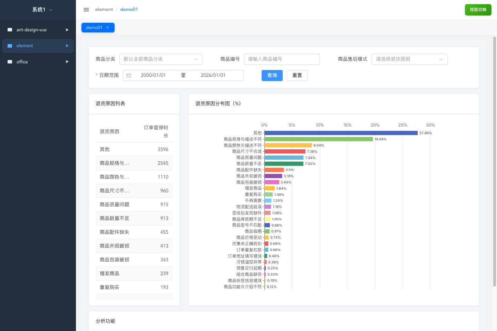
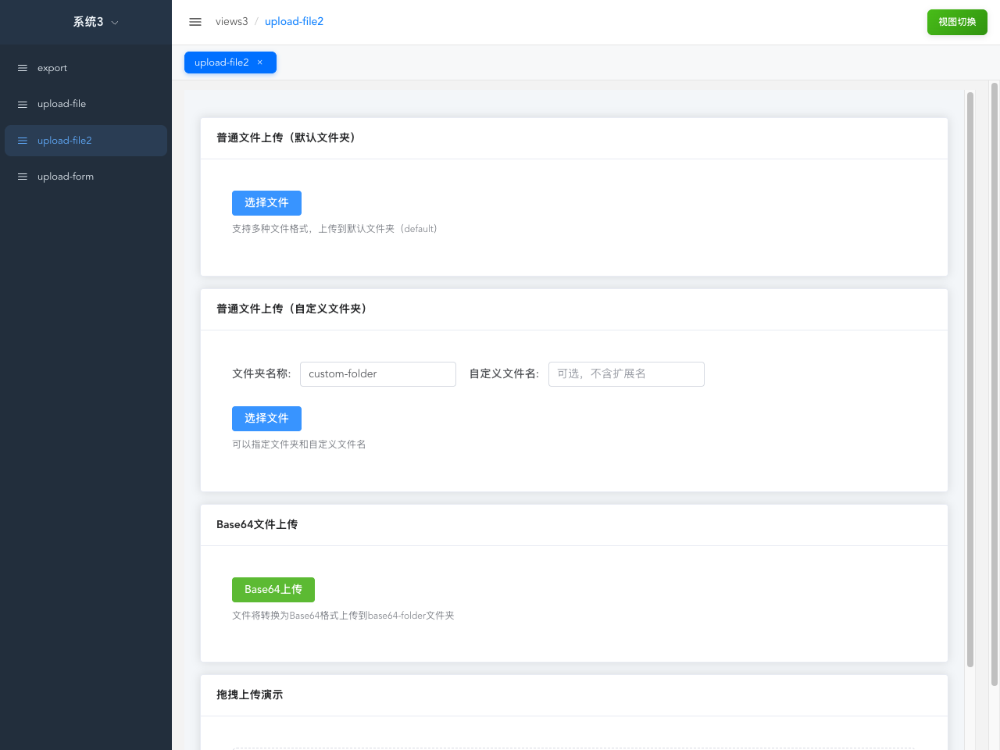

<a id="top"></a>
<div align="center">

# 🚀 Libra Boot Vue

**Load, parse and mount Vue Single-File Components (SFCs, `.vue`) in the browser with vue3-sfc-loader, using statically included libraries such as Element Plus to build lightweight pages without npm installation or a Vite prebuild.**

[](https://vuejs.org/)
[](https://github.com/FranckFreiburger/vue3-sfc-loader)
[](LICENSE)

**English** | [简体中文](README.md)

</div>

> This README follows the open-source documentation standard: consistent structure and badges, public badge resources only, and release-channel pages for current versions.

**Source code**: [GitHub](https://github.com/halavah/libra-boot-vue) · [Gitee](https://gitee.com/halavah/libra-boot-vue)

**Usage documentation**: this README includes the static workflow, component mounting, directory conventions and limitations.

**Versions and updates**: [GitHub Tags](https://github.com/halavah/libra-boot-vue/tags) · [Releases](https://github.com/halavah/libra-boot-vue/releases)

## 📖 Contents

- [Quick start](#quick-start)
- [Running examples](#screenshots)
- [Get the source](#source)
- [How browser loading works](#runtime)
- [Mount your own component](#component)
- [Directory structure](#structure)
- [Optional Vite development](#vite)
- [Limitations and troubleshooting](#limits)
- [Verification scope](#verification)
- [Contributing](#contributing)
- [License](#license)
- [Contact](#contact)
- [Star History](#star-history)
- [Back to top](#back-to-top)

<a id="quick-start"></a>
## 🚀 Quick start

You need Git, Python 3 and a modern browser supporting Vue 3, Fetch and modern JavaScript. Python only supplies a static HTTP server; an existing static server also works. This workflow does not require Node.js, npm or pnpm.

```sh
git clone https://github.com/halavah/libra-boot-vue.git
cd libra-boot-vue
python3 -m http.server 5174 --bind 127.0.0.1
```

Start the server from the **repository root**, then open:

- Example catalogue: `http://127.0.0.1:5174/test/index.html`
- Element Plus example: `http://127.0.0.1:5174/test/load-component.html?component=element/demo01`
- Ant Design Vue example: `http://127.0.0.1:5174/test/load-component.html?component=ant-design-vue/demo01`

The catalogue lists SFC and standalone HTML examples. Selecting an SFC fetches its source, parses it at runtime and mounts the component. Examples using APIs still need the corresponding services. Press `Ctrl+C` to stop the server. If the port is occupied, choose a free port and update the URLs. Do not open the HTML through `file://`; the loader needs HTTP access to source files and resources.

<a id="screenshots"></a>
## 🖼️ Running examples

These existing screenshots come from the repository's auxiliary Vite examples and show component and chart output. They do not establish that every static entry or backend endpoint works. The data is synthetic e-commerce data.


*Return-reason table and ECharts chart using local demonstration data.*


*File-handling controls and layout; actual upload requires a backend.*

<a id="source"></a>
## 📦 Get the source

| Channel | Access | Details |
|---|---|---|
| Public GitHub source | HTTPS clone command above or ZIP download | The main branch is `master` |
| Gitee source mirror | SSH command below | Configure an SSH public key in Gitee first |
| npm package or hosted business backend | Not provided | Use the source and static assets |

For Gitee, run the following commands and serve the same repository root:

```sh
git clone git@gitee.com:halavah/libra-boot-vue.git
cd libra-boot-vue
python3 -m http.server 5174 --bind 127.0.0.1
```

Keep `test/`, `src/` and `public/` in their relative locations. The entry uses absolute URL paths such as `/public/...` and `/src/...`, so the repository root must be the HTTP document root. Subpath hosting requires adjusting these paths. For public deployment, publish only the required pages, components and browser dependencies; do not expose `.git`, environment files or `node_modules` as static resources.

<a id="runtime"></a>
## 🧩 How browser loading works

An SFC (Single-File Component) keeps a Vue template, script and styles in a `.vue` file. The static entry is `test/load-component.html`:

1. `<script>` and `<link>` tags load browser resources from `public/`, including Vue, Element Plus, Ant Design Vue, ECharts, Axios and Day.js.
2. The `component` query parameter selects a group and example, such as `element/demo01`.
3. `vue3-sfc-loader.loadModule()` loads `/src/views/element/demo01/index.vue`.
4. `moduleCache` maps imports such as `vue` and `element-plus` to loaded global objects. `getFile()` fetches source text, and `addStyle()` adds component styles to the page.
5. `defineAsyncComponent()` creates the component, the UI libraries are registered, and `createApp().mount()` mounts it into `#app`.

The browser parses the `.vue` source at runtime, so no prebuild is required. Loading and compilation still incur runtime work. “Lightweight” describes the workflow and integration, not a claim that dependencies are small or compilation is free.

<a id="component"></a>
## ✍️ Mount your own component

Create `src/views/element/hello/index.vue` with this ordinary Vue SFC:

```vue
<template>
  <el-button type="primary" @click="count++">
    Click count: {{ count }}
  </el-button>
</template>

<script>
export default {
  data() {
    return { count: 0 }
  }
}
</script>
```

With the static server running, open `http://127.0.0.1:5174/test/load-component.html?component=element/hello`. The loader looks for `index.vue` under that group and example directory. The parameter has no `.vue` suffix and is not an arbitrary file URL.

To list it in the catalogue, add `hello` to the `element` array in `test/views.json`. This is a manual catalogue, not a filesystem scan. Standalone HTML entries are listed in `test/views2.json` and link to `src/views2/<group>/<example>/index.html`.

Components may retain the examples' separate `js/` and `css/` files. To add a library, provide its browser distribution and update `moduleCache`. Adding it to `package.json` alone does not make it available to the static loader.

<a id="structure"></a>
## 🗂️ Directory structure

```text
test/
├─ index.html             # Manual example catalogue
├─ load-component.html    # Browser SFC loading and mounting
├─ views.json             # SFC catalogue
└─ views2.json            # Standalone HTML catalogue
public/                   # Browser scripts, library styles, assets and licenses
src/
├─ views/                 # Loader convention: group/example/index.vue
├─ views2/                # Standalone HTML and other examples
├─ views3/                # File-handling and form examples
├─ App.vue / Home.vue     # Optional Vite application
├─ layouts/ / router/     # Vite layouts and routing
├─ mixins/ / plugins/     # Reusable logic
└─ assets/                # Styles and demonstration assets
assets/screenshots/       # README screenshots
```

<a id="vite"></a>
## 🛠️ Optional Vite development

A Vite application is also included for engineering-oriented routing and development-server workflows. It is a separate option, with Node.js 22 or newer and pnpm 9 or newer as the documented environment baseline:

```sh
pnpm install --frozen-lockfile
pnpm dev --host 127.0.0.1 --port 5173 --strictPort
```

Open `http://127.0.0.1:5173/`. `pnpm build` writes `dist/`; afterwards, `pnpm preview --host 127.0.0.1 --port 4173 --strictPort` previews that build. Vite discovery, dependency resolution and output are not the behaviour of the `test/` loader. The static entry continues to use the HTTP-server workflow described above.

<a id="limits"></a>
## ⚠️ Limitations and troubleshooting

| Symptom or boundary | What to check |
|---|---|
| A `.vue`, script or stylesheet returns 404 | Check the HTTP document root; `component=element/demo01` selects `src/views/element/demo01/index.vue` |
| Global styling is missing | The entry references `/styles/global.css`, which is not supplied; provide the required styling or adjust that reference |
| A catalogue entry has no component | The two `demo06-less不可用` entries and old `office` paths are not guaranteed to have matching entries; inspect the files rather than treating the catalogue as a support matrix |
| An added package cannot be imported | Check its browser script and `moduleCache`; the loader does not automatically resolve the npm dependency tree |
| Relative paths, JSON or preprocessor styles fail | `pathResolve()` has explicit prefixes and path rewriting; `../json/` is ignored. Arbitrary Vite aliases, Less/Sass or plugins are not guaranteed to work |
| Upload, authentication or business queries fail | Connect your own backend. Placeholder domains and localhost endpoints are not hosted business services |

Only load components you maintain or trust: JavaScript inside an SFC executes in the current page. Examples use demonstration data or placeholder endpoints. There is no shared Mock backend and no promise that every example runs independently offline.

<a id="verification"></a>
## ✅ Verification scope

The documented loading paths, script dependencies, library mappings and mounting sequence have been checked against the source; screenshot files exist. The static entry still has the missing resources and historical catalogue entries listed above. Source inspection and auxiliary Vite screenshots are not evidence that all static components, actual uploads, backend authentication or mobile compatibility have passed runtime tests.

<a id="contributing"></a>
## 🤝 Contributing

Create a feature branch from `master`, or Fork the repository and submit a PR. Preserve component structure, directories and code formatting. When changing entries, dependency mappings or catalogue data, check the affected static paths and update both README languages. State which checks were run and which were not.

Use synthetic e-commerce data. Do not commit real accounts, private endpoints, credentials, environment files or resources without appropriate permission. Retain third-party licenses alongside their assets.

<a id="license"></a>
## 📄 License

[MIT License](LICENSE) covers the project's own code. It allows commercial use, modification, redistribution and private use, with the copyright and permission notice retained in copies or substantial portions. No warranty is provided. MIT makes lightweight pages and component examples straightforward to reuse; third-party assets in `public/` retain their respective licenses.

<a id="contact"></a>
## 📮 Contact

Maintainer: [halavah](https://github.com/halavah). Use [Issues](https://github.com/halavah/libra-boot-vue/issues) or a PR to provide file locations, reproduction steps and sanitized evidence.

<a id="star-history"></a>
## ⭐ Star History

If the project helps you, consider giving it a Star.

[](https://www.star-history.com/#halavah/libra-boot-vue&Date)

<a id="back-to-top"></a>
## ⬆ Back to top

用 ❤️ 构建 | Made with ❤️

[⬆ Back to top](#top)
